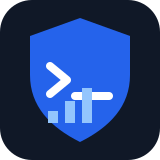

<p align="center"></p>
<h1 align="center">Auto Maintain Bench</h1>
<p align="center"><strong>A deterministic proving ground for tiny local models that repair Linux hosts through a single bash tool.</strong></p>
<p align="center">172 sandboxed maintenance scenarios. One command per turn. No LLM judge.</p>
<p align="center"><a href="README.zh-CN.md">简体中文</a> · <a href="LICENSE">GPL-3.0</a> · Python 3.10+</p>

> **Status: closed research milestone (2026-09-29).** The harness and scenario
> corpus reached a usable research state. No further development is planned;
> future work may continue in [Help Agent](https://github.com/ZisIsNotZis/helpagent),
> which may supersede this benchmark.

## 🚀 Quick start

Prerequisites: Python **3.10+**, Docker, and a `llama-server` binary (or a compatible OpenAI-style endpoint). Model weights are not included; supply a local GGUF file or point the runner at an existing server.

```bash
git clone https://github.com/ZisIsNotZis/auto_maintain_bench.git
cd auto_maintain_bench
python3 benchmark/run.py --model /path/to/model.gguf \
  --scenario CPU-001 --output /tmp/auto-maintain-cpu.json
```

The local runner starts `llama-server` and uses `local-os/default:latest` for the Docker sandbox. For an existing server:

```bash
python3 benchmark/run.py --model local-model \
  --base-url http://127.0.0.1:8080/v1 \
  --scenario CFG-001 --output /tmp/result.json
```

Run the full corpus and save trajectories outside the repository:

```bash
python3 benchmark/run.py --model ./model.gguf --concurrency 4 \
  --trajectory-dir /tmp/maintain-trajectories --version v1 --output /tmp/all.json
```

## ✅ What it can do now

- **Run 172 scenario projects across 18 categories** in isolated Docker sandboxes: CPU, memory, disk, network, config, processes, security, artifacts, services, and user requests.
- **Drive a local GGUF model through `llama-server`, or any OpenAI-compatible endpoint.**
- **Enforce a narrow tool contract:** one bash call per turn, `everything_ok` or `escalate <level> <message>` to finish, backup before mutation, and cached duplicate commands.
- **Score observable outcomes deterministically:** fix 60%, durability 20%, safety 15%, terminal behavior 5%. No second model grades the first.
- **Record per-scenario trajectories** and regenerate benchmark tables with `scripts/update_benchmarks.py`.
- **Exercise a production-loop proof of concept** with `harness/maintain.py`, where `MEMORY.md` is the only cross-cycle model memory.
- **Compare recorded runs** for 0.8B–9B models in [BENCHMARKS.md](BENCHMARKS.md).

### Why this benchmark

Small models are rarely tested on whether they can safely repair an operational problem. This project asks a concrete question: *can a small local model diagnose the host, make the smallest safe change, verify it, and stop—or escalate when it should?*

- **Reproducible:** fixed telemetry, prompts, seed, checks, and scenario state.
- **Observable:** every point comes from a check, not an opinion.
- **Safety-aware:** unexpected changes or a false `everything_ok` cap the maximum score at **0.25**.
- **Local-first:** the native path has **no third-party Python dependencies** and can run entirely against a local model.
- **Operationally shaped:** scenarios are real project fixtures with runtime evidence, not trivia questions.

## 🧭 Architecture

Three layers, one runtime contract:

| Layer | Path | Role |
| --- | --- | --- |
| Scenario corpus | `scenarios/` | 172 self-contained projects: telemetry, fixture, repair README, checks, and scoring metadata |
| Harness | `harness/` | Prompt policy, bash tool schema, maintenance loop, Docker sandbox, contracts, scoring, telemetry, and the production-loop daemon |
| Benchmark runner | `benchmark/run.py` | CLI that selects scenarios, runs the harness, and writes JSON reports and trajectories |

Supporting material lives in `tests/` (standard-library checks), `docs/` (design, catalog, ADRs, failure analysis, telemetry), and `scripts/` (local probes and benchmark helpers).

A single run flows through the same five steps every time:

1. A scenario supplies bounded telemetry, a project README, expected terminal behavior, checks, and an allowed-change contract.
2. The model emits exactly one bash tool call per turn; Docker executes it in an isolated sandbox.
3. The harness validates the call, enforces backup and path rules, and records the result.
4. Fix, durability, safety, and terminal checks produce a score and an optional trajectory JSON.
5. The runner aggregates results into a report that can be compared across models and prompt versions.

## 🧪 How to develop

No package installation is required for the native test suite:

```bash
python3 -m unittest discover -s tests -p 'test_*.py' -v
```

Docker-backed tests run when Docker is available and are skipped otherwise. To start a local inference server manually:

```bash
PORT=8091 ./scripts/start_llama_server.sh /path/to/model.gguf
```

See [CONTRIBUTING.md](CONTRIBUTING.md) for contribution rules and [docs/README.md](docs/README.md) for the design and benchmark references.

## 🤝 How to contribute

Contributions are welcome, especially deterministic scenarios with explicit validators, sandbox probes, adapters, and analysis tools. Keep tests host-safe, avoid cloud dependencies, and explain the effect on score interpretation.

Start with [CONTRIBUTING.md](CONTRIBUTING.md), [CODE_OF_CONDUCT.md](CODE_OF_CONDUCT.md), and [SECURITY.md](SECURITY.md). The project status and evidence boundary are recorded in [docs/project-status.md](docs/project-status.md).

## 🛣️ Roadmap

### Implemented

- A 172-project deterministic corpus across 18 categories, with fix, regression, and durability checks.
- A Docker-isolated bash agent loop with backup-before-mutation, duplicate detection, and terminal-command validation.
- Deterministic scoring without an LLM judge, including safety caps for unexpected changes and false success.
- Local GGUF and remote OpenAI-compatible transports, trajectory capture, and generated benchmark tables.
- A production-loop proof of concept with periodic telemetry and `MEMORY.md` continuity.
- Recorded comparisons for 0.8B, 2B, 4B, and 9B models in [BENCHMARKS.md](BENCHMARKS.md).

### Planned (not scheduled — the project is closed)

- Add high-value edge cases while keeping scenario and scoring contracts stable.
- Improve local-model and existing-server adapters.
- Publish clearer cross-model reports and failure-reproduction workflows.
- Require sandboxing, approval, rollback, telemetry integrity, and durable verification before any daemon integration.

**Future vision:** this could become a trusted evaluation and regression suite for an edge maintenance daemon—not an autonomous root shell. The value is a repeatable way to discover where a small model stops being safe, and to prove when a change actually made it better.

## ⚠️ Caveats

- Results depend on model weights, quantization, prompt version, server settings, Docker image, and host resources.
- A successful score does not prove safety on an unmodeled host.
- Full runs can take **15–30 minutes** at concurrency 4 and require substantial resources.
- Model files are machine-local and are not portable repository assets.
- `scripts/` contains workstation-specific model paths; adapt them before use.
- Benchmark labels such as `v12` identify optimization passes, not compatibility guarantees. Keep model, prompt, runtime, and commit metadata with every result.

## 📜 License

Licensed under [GNU GPL v3.0](LICENSE).
